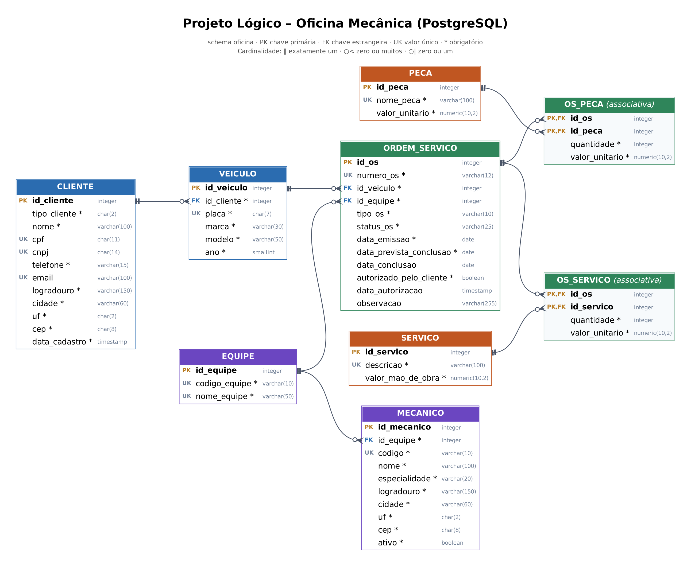

# Projeto Lógico de Banco de Dados – Oficina Mecânica (PostgreSQL)

Esquema lógico e implementação de um banco de dados para o controle de ordens de serviço de uma oficina mecânica, desenvolvido como desafio do curso **"Construindo um Projeto Lógico de Banco de Dados do Zero"** da [DIO](https://www.dio.me/), **adaptado do MySQL (proposta original) para o PostgreSQL**.

Este projeto parte do esquema conceitual disponível em [controle-gerenciamento-oficina-mecanica](https://github.com/DeusdedithJhunior/controle-gerenciamento-oficina-mecanica).

## Descrição e motivo do projeto

O objetivo é percorrer todas as etapas de um projeto de banco de dados: mapear o esquema conceitual (modelo ER) para o modelo relacional, criar o script do esquema, persistir dados de teste e recuperar informações com consultas SQL.

### Contexto do negócio

Clientes levam seus veículos à oficina para conserto ou revisão periódica. Cada veículo é designado a uma equipe de mecânicos, que avalia o que precisa ser feito e emite uma ordem de serviço (OS) com data prevista de entrega. O valor da OS é composto pela mão de obra, consultada em uma tabela de referência, e pelas peças utilizadas. O cliente autoriza a execução, e a mesma equipe que avaliou executa os serviços.

## Tecnologias

- **PostgreSQL** (14 ou superior)
- **DBeaver** como cliente SQL
- **Graphviz** para renderização do diagrama do modelo lógico
- **Git e GitHub** para versionamento

## Do esquema conceitual ao lógico

### Revisão do esquema conceitual

O esquema conceitual foi elaborado com apoio de IA e revisado criticamente na etapa de mapeamento. As correções aplicadas foram:

| Ponto no esquema conceitual | Problema | Decisão no esquema lógico |
| --- | --- | --- |
| Veículo N:1 Equipe | O mesmo veículo pode ser atendido por equipes diferentes em visitas diferentes; um vínculo fixo geraria dados contraditórios | A equipe fica **apenas na OS** |
| `ValorTotal` na OS | Atributo derivado (soma de serviços e peças); armazená-lo permite divergência com os itens | **Não é armazenado**; é calculado nas consultas |
| `CodigoEquipe` (diagrama) x `NomeEquipe` (texto) | Inconsistência entre diagrama e documentação | Os dois atributos foram mantidos, ambos únicos |
| `AutorizadoPeloCliente` | Presente no texto, ausente no diagrama | Incluído na OS, junto com a data da autorização |
| Cardinalidade "2" em Veículo–Equipe | Notação inválida | Relacionamento removido (ver primeira linha) |
| `Endereço` | Atributo composto | Decomposto em logradouro, cidade, UF e CEP |
| Itens da OS sem preço | Alterar a tabela de mão de obra ou de peças mudaria o valor de OS antigas | `valor_unitario` em `os_servico` e `os_peca` guarda o **preço praticado** |

Também foram acrescentados atributos previstos na narrativa do negócio: data prevista de conclusão da OS (prometida ao cliente) e tipo da OS (conserto ou revisão).

### Algoritmo de mapeamento ER → relacional

| Passo | Regra | Aplicação neste projeto |
| --- | --- | --- |
| 1 | Entidades regulares viram tabelas; atributos compostos são decompostos | `cliente`, `veiculo`, `equipe`, `mecanico`, `servico`, `peca`, `ordem_servico` |
| 2 | Entidades fracas viram tabelas com a PK do dono | Não há: veículo e OS têm identificadores próprios (placa e número da OS) |
| 3 | Relacionamentos 1:1 viram FK em um dos lados | Não há no modelo |
| 4 | Relacionamentos 1:N viram FK no lado N | `veiculo.id_cliente`, `mecanico.id_equipe`, `ordem_servico.id_veiculo`, `ordem_servico.id_equipe` |
| 5 | Relacionamentos N:M viram tabelas associativas | `os_servico` e `os_peca`, com PK composta |
| 6 | Atributos multivalorados viram tabelas próprias | Não há no modelo |
| 7 | Relacionamentos n-ários viram tabelas próprias | Não há no modelo |

## Regras de negócio implementadas

As regras são garantidas pelo próprio banco, por meio de constraints:

| Regra | Como foi implementada |
| --- | --- |
| Nenhuma OS é executada sem autorização do cliente | `CHECK` impede os status `EM_EXECUCAO` e `CONCLUIDA` sem autorização |
| A data de autorização só existe se houve autorização | `CHECK` que amarra a flag à data |
| A data de conclusão só existe em OS concluídas | `CHECK` que amarra o status à data |
| A mesma equipe avalia e executa | Uma única FK de equipe na OS |
| Cliente é PF **ou** PJ, nunca os dois | `CHECK` que exige CPF para PF e CNPJ para PJ |
| Placa válida e única | `UNIQUE` e `CHECK` com expressão regular (padrão antigo e Mercosul) |
| Número da OS padronizado | `CHECK` no formato `OS-AAAA-NNNN` |
| Status e tipos controlados | `CHECK` com a lista de valores permitidos |

No total, o modelo tem **45 constraints nomeadas** (9 PK, 8 FK, 10 UNIQUE e 18 CHECK), com prefixos `pk_`, `fk_`, `uq_` e `ck_`, além de índices nas chaves estrangeiras usadas em JOINs.

## Adaptação para PostgreSQL

O desafio original da DIO é proposto em **MySQL**. Este projeto foi adaptado para o **PostgreSQL**:

| Recurso | MySQL (original) | PostgreSQL (este projeto) |
| --- | --- | --- |
| Chave autoincremental | `AUTO_INCREMENT` | `GENERATED BY DEFAULT AS IDENTITY` (padrão SQL) |
| Valores de domínio (status, tipos) | `ENUM` | `VARCHAR` + constraint `CHECK`, mais fácil de alterar |
| Organização dos objetos | `CREATE DATABASE` | banco `oficina` + schema dedicado `oficina` |
| Índices em chaves estrangeiras | criados automaticamente (InnoDB) | criados explicitamente, pois o PostgreSQL não os cria |
| Validação de formato (placa, nº da OS) | `REGEXP` | operador `~` em constraint `CHECK` |
| Concatenar valores agrupados | `GROUP_CONCAT()` | `string_agg()` |
| Diferença entre datas | `DATEDIFF()` | subtração direta de `DATE` |
| Documentação das tabelas | `COMMENT` na definição | `COMMENT ON TABLE`, visível no DBeaver |

## Modelo lógico



> Diagrama gerado automaticamente a partir do catálogo do PostgreSQL
> (`pg_catalog`) e renderizado com o [Graphviz](https://graphviz.org/).
> Como é extraído do próprio banco, reflete exatamente as tabelas,
> chaves e relacionamentos criados pelo script `01_ddl_criacao_tabelas.sql`.

As cores agrupam as áreas do negócio: **azul** para clientes e veículos, **roxo** para equipes e mecânicos, **verde** para ordens de serviço e seus itens, **laranja** para as tabelas de referência (serviços e peças). Tabelas associativas (relacionamentos N:M) têm fundo claro.

## Estrutura do repositório

```text
projeto-DIO-oficina-postgresql/
├── README.md
├── diagrama/
│   └── modelo-logico-oficina.png      # diagrama (catálogo do PostgreSQL + Graphviz)
└── scripts/
    ├── 01_ddl_criacao_tabelas.sql     # schema, tabelas, constraints e índices
    ├── 02_dml_insercao_dados.sql      # dados fictícios para teste
    └── 03_queries_negocio.sql         # 17 consultas de negócio e validação
```

## Como executar

1. No DBeaver, conectado ao banco `postgres`, crie o banco:

   ```sql
   CREATE DATABASE oficina;
   ```

2. Abra uma conexão apontando para o banco `oficina`.
3. Execute os scripts **na ordem**, cada um inteiro com `Alt + X`:
   `01_ddl_criacao_tabelas.sql` → `02_dml_insercao_dados.sql` → `03_queries_negocio.sql`

> O script 01 recria o schema do zero (`DROP SCHEMA ... CASCADE`), então pode ser executado novamente para reiniciar o ambiente.

## Consultas desenvolvidas

O script `03_queries_negocio.sql` cobre todas as cláusulas pedidas no desafio:

| Cláusula | Exemplos de perguntas respondidas |
| --- | --- |
| `SELECT` e `WHERE` | Quais OS aguardam autorização do cliente? Quais serviços custam entre R$ 100 e R$ 400? |
| Atributos derivados | Valor total de cada OS, dias de atraso na entrega, desconto sobre a tabela de mão de obra |
| `ORDER BY` | Veículos do mais novo ao mais antigo, com idade calculada |
| `GROUP BY` + `HAVING` | Clientes com mais de um veículo, veículos que voltaram à oficina, equipes com faturamento acima de R$ 3.000 |
| `JOIN` | Histórico de um veículo, composição das equipes, OS em aberto com contato do cliente, peças mais usadas, gasto por cliente |

### Exemplo: qual o valor total de cada OS?

```sql
WITH total_servicos AS (
    SELECT id_os, SUM(quantidade * valor_unitario) AS valor_servicos
    FROM os_servico GROUP BY id_os
),
total_pecas AS (
    SELECT id_os, SUM(quantidade * valor_unitario) AS valor_pecas
    FROM os_peca GROUP BY id_os
)
SELECT os.numero_os,
       os.status_os,
       COALESCE(ts.valor_servicos, 0) + COALESCE(tp.valor_pecas, 0) AS valor_total
FROM ordem_servico os
LEFT JOIN total_servicos ts ON ts.id_os = os.id_os
LEFT JOIN total_pecas    tp ON tp.id_os = os.id_os
ORDER BY os.numero_os;
```

Os serviços e as peças são somados separadamente **antes** do JOIN. Juntar as duas tabelas diretamente multiplicaria as linhas e inflaria o total.

## Autor

**Deusdedit Andrade da Silva Junior**
Analista de Dados & Tech Lead

[LinkedIn](https://www.linkedin.com/in/SEU-PERFIL) · [GitHub](https://github.com/DeusdedithJhunior)
